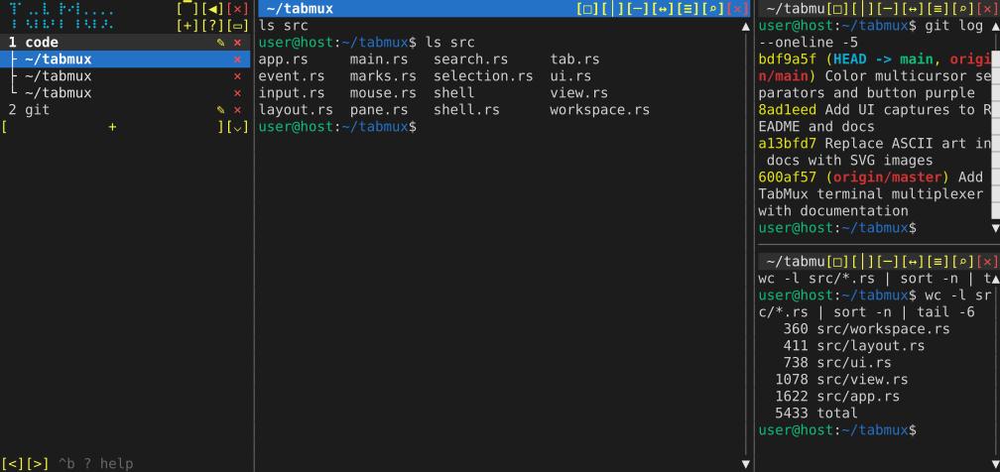

# TabMux

Terminal multiplexer with tabs and split panes, written in Rust.



```sh
tabmux [-w|--workspace <file.toml>]
```

## Features

- Tabs in a sidebar (with a tree of panes) or a top bar
- Nested split panes, which you can resize, zoom, and drag-and-drop between tabs
- Full mouse support: buttons with tooltips, selection, copy via OSC 52,
  middle-click paste. Mouse events are forwarded to programs that ask for them
- tmux-style `^b` prefix keybindings
- Search through the scrollback (smart case), jump between shell prompts
  (`Ctrl+↑/↓`, automatic zsh / bash integration)
- Wide mode (1000-column PTY with horizontal scrolling), multicursor typing
- Bell and activity markers on background tabs
- TOML workspace files: tabs, layouts, commands, env, shell profiles

## Quick start

```sh
scripts/build.sh                          # -> target/release/tabmux
target/release/tabmux -w examples/rust-dev.toml
```

Press `^b ?` inside TabMux for the key list.

```toml
# workspace.toml
[[tab]]
name = "code"
cwd = "~/proj"

[tab.layout]
split = "vertical"
panes = [{ command = "nvim .", size = 2, focus = true }, { command = "cargo test" }]
```

## Documentation

See [`docs/`](docs/README.md):

- [Getting started](docs/getting-started.md)
- [Keybindings](docs/keybindings.md) · [Mouse](docs/mouse.md) · [Features](docs/features.md)
- [Workspace files](docs/workspace.md) · [Shell integration](docs/shell-integration.md)
- [Architecture](docs/architecture.md) · [Contributing](docs/contributing.md)

Examples: [`examples/`](examples).
