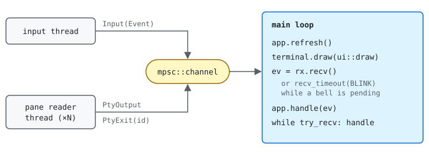

# Architecture

TabMux is a single binary crate (no lib target), Rust edition 2024.

| Crate          | Role                                              |
| -------------- | ------------------------------------------------- |
| `ratatui`      | Terminal UI rendering (`ratatui::init/restore`)   |
| `crossterm`    | Input events, mouse capture, bracketed paste      |
| `portable-pty` | PTY creation and child processes                  |
| `vt100`        | Terminal emulation of each pane (screen + scrollback) |
| `tui-term`     | Draws a `vt100` screen into a ratatui buffer      |
| `serde`, `toml`| Workspace file parsing                            |
| `base64`       | OSC 52 clipboard encoding                         |
| `anyhow`       | Error handling                                    |

## Module map

| Module         | Responsibility                                                         |
| -------------- | ---------------------------------------------------------------------- |
| `main.rs`      | CLI parsing, terminal setup / teardown, event loop                     |
| `event.rs`     | `AppEvent`: `Input(crossterm::Event)`, `PtyOutput`, `PtyExit(id)`      |
| `app.rs`       | `App` state, `refresh()`, keyboard / mouse / PTY event handling        |
| `tab.rs`       | `Tab`: layout root, focus, zoom, sync (multicursor), bell / activity   |
| `layout.rs`    | Binary layout tree `Node`, split geometry, tree edits, drop `Zone`s    |
| `view.rs`      | `View`: all on-screen geometry and the hit list, tooltips, `HELP_LINES` |
| `ui.rs`        | Drawing only, from `App` + `View`                                      |
| `pane.rs`      | PTY spawn, reader thread, `vt100` parser, `Callbacks`, scrolling       |
| `input.rs`     | `KeyEvent` → bytes for the PTY (honors application cursor mode)        |
| `mouse.rs`     | Mouse event → xterm mouse report (SGR / UTF-8 / legacy)                |
| `selection.rs` | Linear text selection, word / line selection, OSC 52                   |
| `search.rs`    | Smart-case search over a pane's history, match stepping                |
| `marks.rs`     | Prompt marks (OSC 133;A) as absolute line numbers                      |
| `shell.rs`     | Automatic zsh / bash integration (`src/shell/*`)                       |
| `workspace.rs` | TOML schema, validation, n-ary → binary layout conversion, path resolution |

## Event loop



- **One channel** carries every event. The input thread forwards crossterm
  events. Each pane has a reader thread that feeds PTY bytes into its parser,
  then sends `PtyOutput`, or `PtyExit(id)` when the PTY closes.
- **Coalescing**: after handling one event, the loop drains all pending ones
  before redrawing, so heavy output doesn't trigger a redraw per chunk.
- **Bell animation**: while a tab has a pending bell, the loop waits with
  `recv_timeout(ui::BLINK)` (500 ms) so the label keeps blinking even
  without events.
- **Teardown**: mouse capture and bracketed paste are turned off and the
  terminal is restored on normal exit, and also from a panic hook.

## Core state (`App`)

```rust
pub struct App {
    pub panes: HashMap<PaneId, Pane>, // every PTY, global
    pub tabs: Vec<Tab>,               // each has a layout tree of PaneIds
    pub active: usize,
    pub mode: Mode,                   // Normal | Prefix | Rename | Help | Search
    pub drag: Drag,                   // current mouse gesture
    pub view: View,                   // geometry, rebuilt every refresh()
    pub selection: Option<Selection>,
    pub search: Option<Search>,
    pub profiles: Vec<(String, SpawnOpts)>,
    pub menu: Option<Menu>,
    // sidebar width / visibility, tab bar kind, titles, status, clipboard…
}
```

Panes are owned by the `App` itself, not by tabs, and tabs only hold
`PaneId`s in their layout tree. Moving a pane to another tab with
drag-and-drop is therefore just an edit of two trees: the PTY and its
process are never restarted.

### Modes and keyboard routing

`App::on_key`:

1. If the profile menu is open → `on_menu_key`.
2. Otherwise dispatch on `Mode`:
   - `Normal`: `^b` → `Prefix`. Global shortcuts (`Ctrl+PgUp/PgDn`,
     `Shift+PgUp/PgDn`, `Ctrl+↑/↓`; the last two only off the alternate
     screen). Any other key is encoded by `input::encode_key` and written to
     `input_ids()`: the focused pane, or every pane of the tab when
     `tab.sync` is set.
   - `Prefix`: `on_prefix_key`, a single command, then back to `Normal`.
   - `Rename(buf)`, `Search`, `Help`: their own key handling.

### Mouse handling and `Drag`

`App::on_mouse`:

1. A drag in progress (`self.drag != Drag::None`) takes every event first:
   `Forward(id)` sends everything to the pane's program, `Drag(Left)` calls
   `on_drag`, and `Up` ends the gesture (drops a pane, copies a selection).
2. Otherwise the position is hit-tested with `view.hit(pos)` → `Target`.
3. The profile menu and the help screen take clicks first when open.
4. `Down` → `on_click(target, …)` with a 1/2/3 click counter (400 ms).
   Wheel and motion events are routed by target.

`Drag` variants: `Sidebar`, `Split(Path)`, `Tab(i)`,
`Pane { id, drop }`, `Select`, `Forward(id)`, `Scrollbar(id)`,
`HScrollbar(id)`, `TabScrollbar`.

## Layout tree (`layout.rs`)

```rust
enum Node {
    Leaf(PaneId),
    Split { dir: Dir, ratio: f32, a: Box<Node>, b: Box<Node> },
}
```

- `Dir::Vertical` places `a | b` side by side, and `Dir::Horizontal` stacks
  `a` above `b`.
- `ratio` is the share given to `a`, clamped to `MIN_RATIO..=MAX_RATIO`
  (0.1–0.9).
- Nodes are addressed by `Path = Vec<bool>` from the root (`false` = `a`,
  `true` = `b`). Separators carry their path, so dragging one calls
  `set_ratio(path, r)`.
- `compute(area)` returns the rect of each leaf and the separator geometry.
- Edits: `split`, `insert(target, Zone, id)`, `remove`, `swap`,
  `move_pane`, `side_of`, `leaves` (in-order; also the sidebar order).
- `Zone::at(rect, x, y)` sorts a cursor position into Left / Right / Top /
  Bottom / Center for drag-and-drop.

Workspace files describe **n-ary** splits with weights.
`workspace::build_split` turns `[c0, c1, …, cn]` into
`Split(c0, Split(c1, …))`, with `ratio = size(c0) / Σ sizes`, so the
proportions stay the same.

## View and hit-testing (`view.rs`)

`View::build(app)` runs on every `refresh()` and computes **all**
geometry: the screen split (sidebar + border or top bar, and main area),
sidebar rows, top-bar tabs, pane views (title, content, scrollbars, close
button), separators, buttons, help box and profile menu.

It also fills a hit list `Vec<(Rect, Target)>`. `View::hit(pos)` searches it
from the end, so **later-pushed hits win**: buttons are pushed after the rows
and titles they sit on, and full-screen overlays (help, menu) after
everything else.

Rule: **geometry lives in `view.rs`, drawing in `ui.rs`.** `ui::draw` only
reads `App` and `View`, and never computes positions itself. Mouse handling
reads the same `View`, so what you see is exactly what you can click.

Tooltips (`Target::tooltip`) and the help text (`HELP_LINES`) live in
`view.rs` too.

## `refresh()`

Called before every draw:

1. For each tab, compute the pane views and **resize each PTY** to its
   content rect (`WIDE_COLS` columns in wide mode, and the full main area
   for a zoomed pane). `Pane::resize` does nothing when the size hasn't
   changed.
2. `update_bells`: collect the bell / output flags of each pane into its tab
   (background tabs only).
3. `update_tab_scroll`: keep the active tab visible in the sidebar.
4. `View::build`.
5. `update_hscroll`: clamp wide-mode horizontal scroll and follow the cursor.
6. If the search is dirty, compute its matches again.

## Panes (`pane.rs`)

`Pane::spawn`:

- Opens a PTY. Runs `opts.shell` or `$SHELL` (fallback `/bin/sh`).
  `shell::inject` adds the integration **before** user arguments, because
  bash wants `--rcfile` before other options. Sets the cwd, then
  `TERM=xterm-256color`, `TABMUX=1` and the `env` from the options.
- If `opts.command` is set, writes it to the PTY followed by `\n`.
- Creates a `vt100::Parser<Callbacks>` (100 000 lines of scrollback) behind
  `Arc<Mutex<_>>`, shared with the reader thread.

`Callbacks` (vt100 hooks) record:

- window title (`set_window_title`),
- bell (`audible_bell` / `visual_bell`),
- an output flag, ignored within `RESIZE_GRACE` (300 ms) of a resize and
  `STARTUP_GRACE` (+700 ms) after spawn, so redraws don't count as activity,
- prompt marks from `unhandled_osc` (OSC 133;A, normal screen only).

Dropping a `Pane` kills its child process and waits for it.

### Prompt marks

`marks::Marks` stores marks as **absolute** line numbers:
`evicted + history_index`. `pane::feed` splits incoming data on `\n`. For
each line feed on the last row while the scrollback is full, one line is
about to be dropped, so it calls `marks.evict()`. This keeps the marks lined
up with the text. `Marks::add` drops marks at or below a new prompt (the
screen was cleared or redrawn). `marks::step` finds the next or previous
mark. `App::jump_prompt` remembers the last jump `(line, offset)` so that
repeated jumps chain from it.

### History and search

`Pane::history()` walks the scrollback page by page to build a list of
every line (scrollback, then screen) plus the maximum scroll offset.
`search::find` matches on chars with smart case and doesn't count
overlapping matches. `Search::set_matches(keep)` tries to keep the current
match when results are computed again after new output.

## Shell integration (`shell.rs`)

`inject(cmd, shell)`: unless `TABMUX_NO_SHELL_INTEGRATION` is set, writes
the embedded scripts (`include_str!("shell/…")`) to `$TMPDIR/tabmux-$USER`
(only when changed). For zsh it moves `ZDOTDIR` there and keeps the user's
value in `TABMUX_ZDOTDIR`. For bash it adds `--rcfile`. See
[Shell integration](shell-integration.md).

## Mouse forwarding (`mouse.rs`)

`encode(kind, mods, col, row, mode, encoding)` follows the program's
`MouseProtocolMode` (Press, PressRelease, ButtonMotion, AnyMotion) and
encoding (SGR, or legacy/UTF-8 where releases are reported as button 3). It
returns `None` when the program doesn't want this kind of event.

## Clipboard (`selection.rs`)

Selections are in pane content coordinates (with the horizontal scroll
added in wide mode). Copying writes `ESC ] 52 ; c ; <base64> BEL` straight
to TabMux's stdout, so the host terminal sets the system clipboard. The text
is also kept in `App.clipboard` for middle-click paste.
