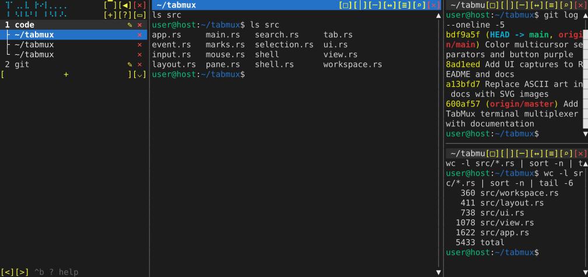
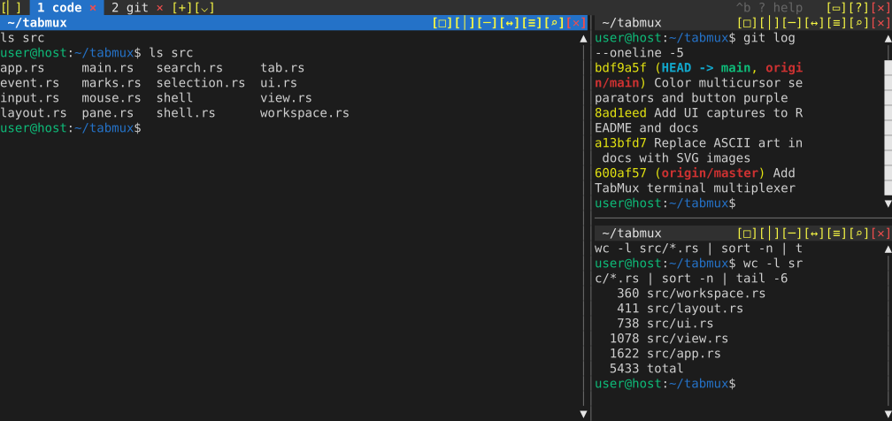

# Getting started

## Requirements

- A Rust toolchain that supports **edition 2024** (Rust 1.85 or newer).
- A Unix-like system (Linux, macOS, WSL). Panes run in real PTYs through
  `portable-pty`.
- A terminal with mouse reporting. To copy text to the system clipboard, the
  terminal must also support OSC 52.

## Building

```sh
scripts/build.sh            # release build -> target/release/tabmux
scripts/build.sh --debug    # debug build   -> target/debug/tabmux
scripts/build.sh --check    # fmt --check, clippy -D warnings and tests, then build
```

Plain `cargo build --release` works too. To install the binary into
`~/.cargo/bin`:

```sh
cargo install --path .
```

## Command line

```text
tabmux [-w|--workspace <file.toml>]
tabmux -h|--help
```

| Option                   | Description                                                   |
| ------------------------ | ------------------------------------------------------------- |
| `-w`, `--workspace FILE` | Load tabs, layouts and commands from a [workspace file](workspace.md). |
| `-h`, `--help`           | Print usage and exit.                                         |

Without `-w`, TabMux opens one tab running a plain shell. If the workspace
file can't be read or is invalid, TabMux prints an error and exits before
taking over the terminal.

```sh
cargo run -- -w examples/rust-dev.toml
```

## What runs in a pane

Each pane runs `$SHELL` in its own PTY (`/bin/sh` if `$SHELL` isn't set).
A workspace [profile](workspace.md#profiles) can run a different program.
Every pane gets these environment variables:

| Variable | Value            |
| -------- | ---------------- |
| `TERM`   | `xterm-256color` |
| `TABMUX` | `1`              |

Scripts can check `TABMUX` to tell whether they run inside TabMux. For zsh and
bash, TabMux also sets up [shell integration](shell-integration.md)
automatically.

When the shell in a pane exits, the pane closes. When a tab loses its last
pane, the tab closes. When the last tab closes, TabMux quits.

## Screen tour



### Tab list

The tab list is shown either as a **sidebar** on the left (the default) or
as a **top bar** one row high. `^b t` switches between the two and `^b s`
hides or shows it.



- **Sidebar**: one row per tab. A tab with more than one pane also lists its
  panes, drawn as a tree. Each tab row has a rename button `✎` and a close
  button `×`, and each pane row has a close button `×`. The `[+]` row below
  the last tab opens a new tab, and `[⌵]` (only shown when the workspace
  defines profiles) opens the profile menu. The header holds the global
  buttons, and the bottom row holds `[<]` / `[>]` to resize the sidebar plus
  the status / mode text. A scrollbar appears when the list overflows.
- **Top bar**: one cell per tab (`×` closes it), `‹` / `›` markers when tabs
  overflow, `[+]` / `[⌵]` after the last tab, and the global buttons on the
  right.

### Global buttons

| Button      | Action                                  |
| ----------- | --------------------------------------- |
| `[▔]` / `[▏]` | Switch sidebar ⇄ top bar (`^b t`)     |
| `[◀]`       | Hide the tab list (`^b s`)              |
| `[▶]`       | Show the tab list (on the first pane title while hidden) |
| `[✕]`       | Quit (`^b q`)                           |
| `[+]`       | New tab (`^b c`)                        |
| `[⌵]`       | New tab from a profile                  |
| `[?]`       | Help screen (`^b ?`)                    |
| `[▭]`       | Show / hide pane title rows (`^b T`)    |

### Pane title rows and pane buttons

Each pane can have a title row showing its window title (set by the program
through the usual OSC title sequence, otherwise `shell N`). The title row also
holds the pane buttons:

| Button        | Action                                         |
| ------------- | ---------------------------------------------- |
| `[□]` / `[▣]` | Zoom / unzoom (`^b z`)                         |
| `[│]`         | Split side by side (`^b %`)                    |
| `[─]`         | Split top / bottom (`^b "`)                    |
| `[↔]` / `[⇔]` | Wide mode off / on (`^b w`)                    |
| `[≡]` / `[▤]` | Multicursor off / on for the tab (`^b m`)      |
| `[⌕]`         | Search history (`^b /`)                        |
| `[✕]`         | Close pane (`^b x`)                            |

When title rows are turned off (`^b T`, or `titles = false` in a workspace),
the focused pane's buttons move into the tab list (sidebar header or top bar)
and each pane shows a small `x` close button above its scrollbar. If the tab
list is hidden too, title rows are shown anyway, because they are the only
place left for the buttons.

Hover over any button to see a tooltip with its keybinding.

### Scrollbars

Each pane has a vertical scrollbar for its scrollback (100 000 lines). In
[wide mode](features.md#wide-mode) it also gets a horizontal scrollbar. You
can click, drag or scroll the mouse wheel on a scrollbar, and the arrow cells
at each end step by a few lines or columns.

### Status line

Short messages ("copied 42 chars", "multicursor on", errors) and the current
mode show up in the sidebar's bottom row or on the right of the top bar.
Messages disappear after 2 seconds.

## Next steps

- [Keybindings](keybindings.md)
- [Workspace files](workspace.md) to open a project layout in one command
